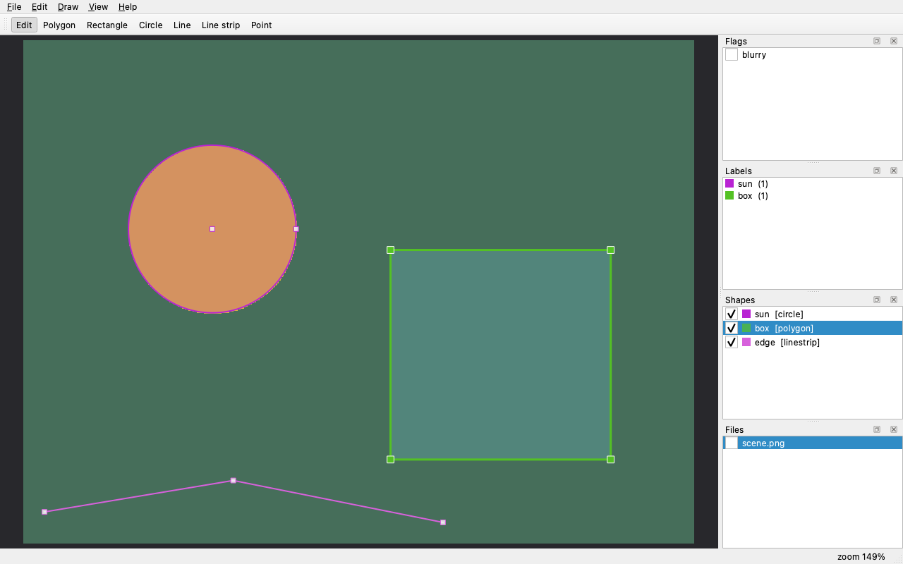

# easy-mask

**Local-first image annotation for computer-vision masks.**

Draw polygons, rectangles, circles, lines and points around the objects *you* care about,
then export pixel masks and datasets ready for training. Everything runs on your machine:
no cloud upload, no account, no telemetry. Click-to-segment with SAM2 is next on the
[roadmap](docs/roadmap.md).



> Status: early alpha. The on-disk format is labelme-compatible, so you can move
> annotations between the two tools.

## Features

| Area | What you get |
| --- | --- |
| Shapes | polygon, rectangle, circle, line, line strip, point |
| Editing | select, move shapes, drag vertices, delete, duplicate, copy/paste, undo/redo |
| Labels | label dialog with autocomplete, per-label colours, group id, description |
| Navigation | open image or folder, file list with done-marks, next/prev, zoom, pan, fit |
| Image flags | per-image checkboxes for classification or cleaning (`--flags`) |
| Saving | one JSON per image next to the image or in `--output`, optional auto-save |
| Export | semantic mask PNG, instance mask PNG, COCO instance JSON, YOLO-seg TXT |

## Install

Requires [uv](https://docs.astral.sh/uv/) and Python 3.12+ (uv fetches Python for you).

```bash
git clone https://github.com/Dharun235/easy-mask.git
cd easy-mask
uv sync
```

## Usage

```bash
uv run easy-mask                              # empty window, open from the File menu
uv run easy-mask photo.jpg                    # annotate one image
uv run easy-mask images/ --output labels/     # annotate a folder, JSON goes to labels/
uv run easy-mask images/ --labels cat,dog     # predefine labels (or --labels labels.txt)
uv run easy-mask images/ --flags blurry,occluded --autosave

# export a folder of annotations to a training dataset
uv run easy-mask export images/ --format coco --out dataset/
uv run easy-mask export images/ --format masks --out dataset/   # semantic + instance PNGs
uv run easy-mask export images/ --format yolo --out dataset/
```

### Keyboard shortcuts

| Key | Action | Key | Action |
| --- | --- | --- | --- |
| `P` | polygon | `E` / `Esc` | edit (select) mode |
| `R` | rectangle | `Enter` | close current polygon / strip |
| `C` | circle | `Backspace` | remove last point while drawing |
| `L` | line | `Delete` | delete selected shape |
| `T` | line strip | `Ctrl+D` | duplicate selected shape |
| `O` | point | `Ctrl+Z` / `Ctrl+Shift+Z` | undo / redo |
| `D` / `A` | next / previous image | `Ctrl+S` | save |
| `Ctrl+wheel` | zoom at cursor | wheel / middle-drag | pan |
| `F` | fit image to window | `Ctrl+C` / `Ctrl+V` | copy / paste shape |

## Annotation format

One JSON per image, compatible with [labelme](https://github.com/wkentaro/labelme):

```json
{
  "version": "0.1.0",
  "imagePath": "photo.jpg",
  "imageHeight": 480,
  "imageWidth": 640,
  "flags": {"blurry": false},
  "shapes": [
    {"label": "cat", "shape_type": "polygon", "points": [[10, 10], [50, 12], [30, 60]],
     "group_id": null, "description": "", "flags": {}}
  ]
}
```

Rectangles store two opposite corners; circles store the centre and one point on the rim.

## Development

```bash
uv sync                      # installs dev tools too
uv run pre-commit install    # ruff on every commit
uv run pytest                # tests (GUI tests run headless)
uv run ruff check . && uv run ruff format --check .
```

Read [CONTRIBUTING.md](CONTRIBUTING.md) and [docs/architecture.md](docs/architecture.md)
before your first PR. AI assistants: see [CLAUDE.md](CLAUDE.md).

## License

[Apache-2.0](LICENSE). easy-mask is an independent implementation; it shares labelme's file
format but no code.
